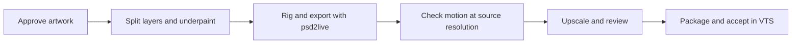

<div align="center">

# Live2D Agent Kit

[简体中文](README.md) · [English](README.en.md)


[](docs/workflow.md)
[](docs/case-study.md)
[](THIRD_PARTY_NOTICES.md)
[](examples/pink-sakura/LICENSE.md)

[Example model](#example-model-pink-sakura) · [Quick start](#quick-start) · [Workflow](docs/workflow.md) · [Tool catalog](tools/README.md) · [Agent Skill](SKILL.md)

</div>

Live2D Agent Kit gives Codex and other coding agents a workflow for turning reference art or layered PSDs into runnable Live2D models. It includes layer recipes, psd2live adapters, anime upscaling scripts, a browser preview, and tools for motion checks and packaging.

The workflow grew out of character production with **GPT-6 Astra Ultra**. Start with the included examples, then ask your agent to follow the same process with your own artwork. A single illustration still needs underpainting for hidden eyelids, the mouth interior, hair and clothing. Artwork approval, layer cleanup and motion review remain part of the job.

## Example model: Pink Sakura

[Pink Sakura](examples/pink-sakura/README.md) includes source art, a layer recipe, an HD runtime model and verification records. The screenshots and animation below come from the model's WebGL canvas. The animation uses synthetic tracking input.

| Reference art | Rigged model | Motion preview |
| :---: | :---: | :---: |
|  |  |  |

| Feature | Included in the example |
| --- | --- |
| Structure | 24 source layers, 26 drawables, 24 parameters |
| Rigging | Independent eyebrows, eyes, mouth shapes, head/body movement, breathing and 8 hair parameters |
| Motions | Idle, Blink, Nod, Shake |
| HD texture | `realesr-animevideov3-x4`, from a 2048² atlas to 8192² |

[Runtime files](examples/pink-sakura/runtime/) · [Rebuild the model](examples/pink-sakura/README.md#复现模板) · [Face closeups and test records](examples/pink-sakura/verification/README.md)

This example uses a conservative 2D rig with a single body layer and no independent arm or finger rigging. Some details remain rough at close range: the closed lip line is faint, partially closed lashes are thick, and `EyeOpen` stays closed between 0 and 0.25. See the [continuous-motion review](examples/pink-sakura/verification/continuous-20261017/README.md) for the remaining issues. Final VTube Studio acceptance is left to the user.

The provider attributes the reference image to **ChatGPT Image2.5**. The example artwork and model use [CC BY 4.0](examples/pink-sakura/LICENSE.md): you may use and modify them with attribution and a description of your changes. Do not claim to be the original creator. Underpainting and model production have separate provenance records.

## Quick start

Install **Git, Python 3.10+ and JDK 21**. Character recipes and browser checks also need **Node.js 22+**. Production and validation were performed on macOS / Apple M4; other platforms need their own compatibility checks. See [setup](docs/setup.md) for Java, official Core and browser dependencies.

### Export the minimal example

```sh
git clone https://github.com/Ariakage/live2d-agent-kit.git
cd live2d-agent-kit

bash scripts/doctor.sh
bash scripts/setup-psd2live.sh
java --source 21 examples/minimal-model/GenerateExample.java work/minimal/assets
bash scripts/export-model.sh work/minimal/assets/manifest.json work/minimal/low
bash scripts/validate.sh --model work/minimal/low/Minimal.model3.json
```

These commands generate 16 original geometric layers and export PSD, CMO3, MOC3 and a 1024² atlas. The final command checks file structure. To test model evaluation and rendering, follow the [Core setup](docs/setup.md#配置本机官方-core) and [browser preview guide](templates/web-preview/README.md). The first build downloads dependencies.

Run commands from the repository root. Generated files go into `work/`; use a new output directory for each attempt to preserve earlier results.

### Make a character from your own art

Give your agent the image or PSD and this prompt:

```text
Read SKILL.md, tools/README.md and docs/workflow.md, then build my Live2D model.
Check the tools and export the minimal example before approving art, splitting layers and rigging.
Preserve the face and style I approve. Fix artwork and seams before anime upscaling.
Deliver rebuildable sources, a complete runtime package, a model preview and test records.
Report Core, browser and VTube Studio acceptance separately.
```

[SKILL.md](SKILL.md) contains the production rules. The [Astra task prompt](prompts/astra.md) covers longer jobs with several rounds of underpainting, rigging and repair. Most detailed guides are currently in Chinese.

## Production workflow



Repair the source layers before increasing resolution. If a hair layer contains pixels from a suspender, those pixels will move with the hair; upscaling only makes the break easier to see. The [troubleshooting guide](docs/troubleshooting.md) covers this and other issues such as mouth skin patches, broken blink lines and hair seams. Follow the [full workflow](docs/workflow.md) for each production stage.

Pink Sakura uses **`realesr-animevideov3-x4`** through Upscayl's NCNN CLI. RGB and alpha are processed separately while atlas layout, geometry and UVs stay unchanged. The low-resolution and HD models have byte-identical MOC files. This improves runtime textures; it does not turn every source PSD layer into 4× editable artwork. Weight downloads, SHA-256 hashes and settings are in the [upscaling guide](docs/upscaling.md).

**Later psd2live work is documented too:** Shironeko development used the 1.3.0 GUI/MCP, Swing authoring and CMO editing, followed by 1.4.0 physics import. See the [version and migration notes](docs/psd2live-versions.md) for the exact commits, operations and limitations. The minimal example and Pink Sakura commands above still use the original pinned engine. Its patches must not be applied to a newer checkout without a separate migration.

## Browser preview and camera tracking

The preview loads a real `.moc3` and provides parameter sliders, VTS-style synthetic inputs, pause controls and a timeline for checking combined motion. Set up the local dependencies using the [preview guide](templates/web-preview/README.md).

Optional camera tracking covers eyebrows, blinking, gaze, mouth shapes, head angles and single-camera estimates of shoulders and torso. Camera access begins only when you click the start button. Inference runs locally in the browser, without uploading or recording video or requesting a microphone. Switching input sources or leaving the page releases the camera. Upper-body tracking is approximate, and the model needs matching rigging for those inputs to produce visible movement.

[Setup and calibration](docs/camera-tracking.md) · [Migrate an existing model](docs/migrate-existing-model.md) · [Camera test records](docs/verification/README.md#真实摄像头与网络边界)

The preview also has independent video, landmark and 2D gaze display switches, plus camera-session statistics. Models with expression presets can switch them smoothly during tracking or while paused. Pink does not yet include an expression preset library; these browser controls do not add model rigging. See the [camera guide](docs/camera-tracking.md).

## Reproduction and verification

**You do not need the author's original `work/` directory.** Pink Sakura's source images, eyebrow preparation script, layer recipe and runtime model are committed. Temporary files and caches can be regenerated. Obtain the official SDK, browser libraries, Upscayl and upscaling weights separately.

| In this repository | Prepare locally |
| --- | --- |
| Example artwork, recipes and HD runtime model | Authorized artwork for your own character |
| Pinned engine configuration, adapters and patches | Build dependencies, official Core and browser libraries |
| Check scripts, reports and weight source hashes | Upscayl, matching weights and temporary output directories |

The CMO3 retains the rig, but its editable layers are reconstructed from the atlas rather than the original PSD editing chain. Keep the published source images and recipes alongside it for further editing or rebuilding. See [reproducibility](docs/reproducibility.md).

Each report identifies the commit or files it tested. Recent records are summarized below; the [verification index](docs/verification/README.md) keeps the full results.

| Check | Recorded result |
| --- | --- |
| [Preview interactions, 2026-10-18](docs/verification/web-features-20261018.json) | 61 Python, 59 Node and 38 real WebGL checks; synthetic callbacks test overlays, expressions and statistics without opening a camera |
| [Pink Sakura continuous motion, 2026-10-17](examples/pink-sakura/verification/continuous-20261017/README.md) | 6 paths and 1,488 completed render frames, including return paths, reversals and neutral reset; contact-sheet overview and selected full-size inspections |
| [Core and browser checks from the same run](examples/pink-sakura/verification/continuous-20261017/summary.json) | 202 Core poses, 22 Web checks, 91 static captures; runtime ZIP extraction and hash checks passed |
| [Fresh source archive, `e2c4679`](docs/verification/source-package-e2c4679.json) | 61 Python and 35 Node tests passed; regenerated 3 eyebrow PNGs, the 24-layer Pink recipe and the 16-layer geometric example |
| [Earlier device and build checks](docs/verification/README.md) | 16 physical-camera checks at `7f391f4`, plus a separately recorded cold engine build |

Source regeneration, engine compilation, rendering and device tests have separate records. None replaces final VTube Studio acceptance. The latest continuous-motion run did not repeat camera testing, neural upscaling or the cold engine build.

## Tools and guides

Adapters, patches and scripts are included; third-party applications, SDKs and weights come from their upstream projects. The [complete tool catalog](tools/README.md) distinguishes production use, validation and evaluation, with versions, sources and license notes.

| Purpose | Tools and sources | Guide |
| --- | --- | --- |
| Rigging and export | [psd2live](https://github.com/tsunehimatoi/psd2live) · [Agent architecture](https://github.com/tsunehimatoi/psd2live/blob/5526f2e16b57e5f83d34f33730d6fa26d8bc8695/docs/zh/AGENT_ARCHITECTURE.md) | [Pinned adapter](integrations/psd2live/README.md) · [Later GUI/MCP use](docs/psd2live-versions.md) |
| Official environment reference | [Live2D Simple Model](https://www.live2d.com/en/learn/sample/simple-model/) · [Cubism SDK](https://www.live2d.com/en/sdk/download/) | [Core setup](docs/setup.md#配置本机官方-core) |
| Anime upscaling | [Upscayl](https://github.com/upscayl/upscayl) · [custom-models](https://github.com/upscayl/custom-models) · [upscayl-ncnn](https://github.com/upscayl/upscayl-ncnn) · [Real-ESRGAN](https://github.com/xinntao/Real-ESRGAN) | [Model selection and settings](docs/upscaling.md) |
| Browser rendering and checks | [PixiJS](https://github.com/pixijs/pixijs) · [pixi-live2d-display](https://github.com/guansss/pixi-live2d-display) · [Playwright](https://github.com/microsoft/playwright) | [Preview template](templates/web-preview/README.md) |
| Camera tracking | [MediaPipe Tasks Vision](https://github.com/google-ai-edge/mediapipe) | [Camera guide](docs/camera-tracking.md) |
| Other skills and MCP servers | [CLI-Anything Live2D](https://github.com/HKUDS/CLI-Anything/blob/main/live2d/agent-harness/cli_anything/live2d/skills/SKILL.md) · [CubismExternalEditMCP](https://github.com/nana7chi/CubismExternalEditMCP) | [Evaluated capabilities and limits](mcp/README.md) |

Further reading: [Layer coordinates](docs/manifest.md) · [Troubleshooting](docs/troubleshooting.md) · [Command reference](tools/commands.md) · [Case study](docs/case-study.md) · [Changelog](CHANGELOG.md)

## Licensing and attribution

| Content | License |
| --- | --- |
| Original standalone code, documentation and prompts | [MIT](LICENSE) |
| psd2live patches and Kotlin integration code | [GPL-3.0-only](THIRD_PARTY_NOTICES.md) |
| Pink Sakura artwork, model and README banner | [Example CC BY 4.0](examples/pink-sakura/LICENSE.md) · [Banner CC BY 4.0](assets/readme/README.md) |
| Third-party tools, SDKs, official samples and weights | Their own terms; see [third-party notices](THIRD_PARTY_NOTICES.md) |

Public model files can be copied. Provenance records, attribution files and optional watermarks help trace their origin; they do not prevent extraction. See [model protection](docs/model-protection.md). The README banner was generated with Imagegen; example screenshots come from actual WebGL rendering.

**This project is not affiliated with Live2D Inc.**

## Star History

<a href="https://www.star-history.com/?repos=ariakage%2Flive2d-agent-kit&type=date&legend=top-left">
 <picture>
   <source media="(prefers-color-scheme: dark)" srcset="https://api.star-history.com/chart?repos=ariakage/live2d-agent-kit&type=date&theme=dark&legend=top-left" />
   <source media="(prefers-color-scheme: light)" srcset="https://api.star-history.com/chart?repos=ariakage/live2d-agent-kit&type=date&legend=top-left" />
   
 </picture>
</a>
