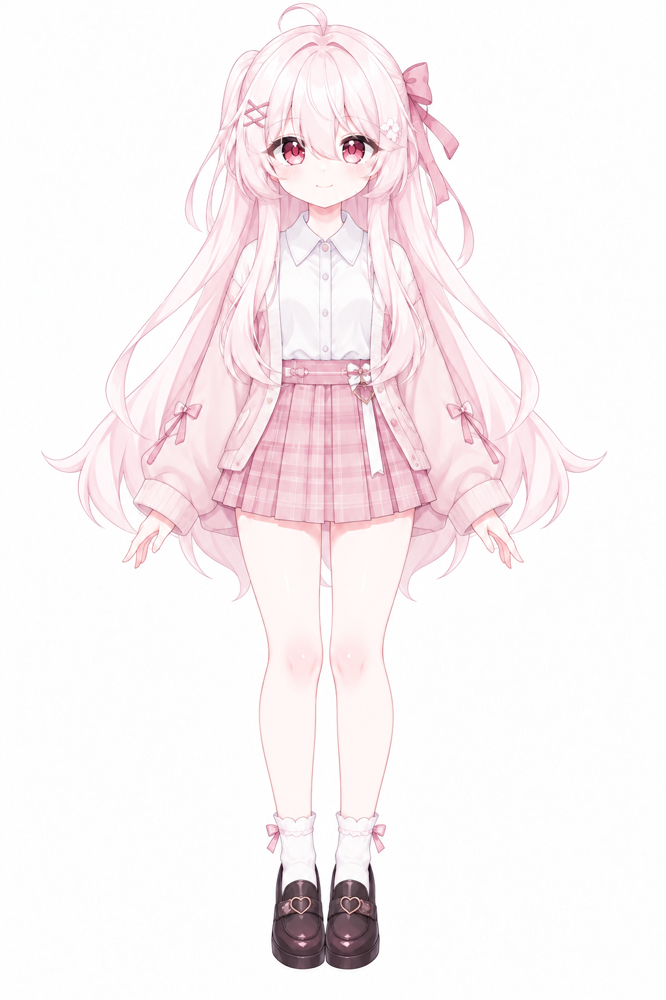
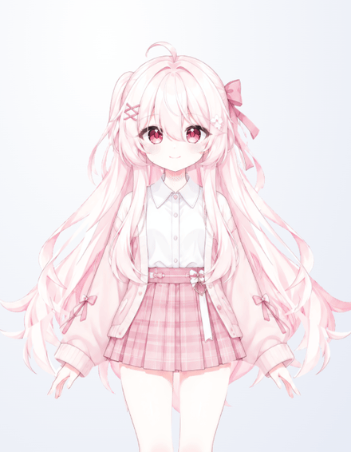
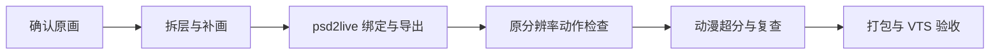

<div align="center">

# Live2D Agent Kit

[简体中文](README.md) · [English](README.en.md)


[](docs/workflow.md)
[](docs/case-study.md)
[](THIRD_PARTY_NOTICES.md)
[](examples/pink-sakura/LICENSE.md)

[模型示例](#模型示例pink-sakura) · [快速开始](#快速开始) · [制作流程](docs/workflow.md) · [工具目录](tools/README.md) · [Agent Skill](SKILL.md)

</div>

Live2D Agent Kit 是一套供 Codex 和其他 coding agent 使用的角色制作工具与工作流程，帮助你从参考图或分层 PSD 制作可运行的 Live2D 模型。仓库包含拆层配方、psd2live 适配器、动漫超分脚本、网页预览，以及动作检查和打包工具。

这套流程来自使用 **GPT-6 Astra Ultra** 完成的角色制作实践。你可以先运行仓库里的示例，再让 agent 按同样的步骤制作自己的角色。单张立绘中被遮住的眼皮、口腔、头发和衣服仍需补画；制作过程中需要确认画风，并检查拆层和动作效果。

## 模型示例：Pink Sakura

[Pink Sakura](examples/pink-sakura/README.md) 提供源图、拆层配方、高清运行模型和验证记录。下方截图和动画来自早期眉毛版本的 WebGL 画布；动画使用合成面捕输入。最新身体动态的画面与检查记录见[动态验证](examples/pink-sakura/verification/dynamics-20261020/README.md)。

| 原始参考图 | 绑定后的模型 | 动作预览 |
| :---: | :---: | :---: |
|  |  |  |

| 项目 | 示例内容 |
| --- | --- |
| 模型结构 | 24 个源图层、26 个 Drawable、37 个参数 |
| 可动部位 | 独立眉眼与嘴形、头身、双肩、胸腰、轻微上臂摆动、袖口、裙摆、发饰与发丝 |
| 内置动作 | 10 个动作，含 Quiet / Curious / Sleepy 三套待机、Airy、慢眨眼与 SpeechBob |
| 表情与物理 | 8 个参数表情、14 组物理；支持 Float 与 Wind |
| 高清纹理 | `realesr-animevideov3-x4`，图集从 2048² 提升到 8192² |

[运行文件](examples/pink-sakura/runtime/) · [重建这个模型](examples/pink-sakura/README.md#复现模板) · [脸部近景与测试记录](examples/pink-sakura/verification/README.md)

身体和衣袖保留为连续图层，用局部变形器实现双肩、胸腰和轻微上臂摆动；这版没有托下巴、比心、招手或手指绑定。放大看仍有闭唇线偏淡、半闭眼睫毛偏厚等细节，`EyeOpen` 在 0～0.25 之间保持闭眼姿态。具体范围见[动态验证](examples/pink-sakura/verification/dynamics-20261020/README.md)，VTube Studio 的最终效果由使用者验收。

原始参考图按提供者说明标注：**此图片来自 ChatGPT Image2.5 生成**。示例图片与模型采用 [CC BY 4.0](examples/pink-sakura/LICENSE.md)，允许署名使用和修改，请保留来源与修改说明，不要冒认原作者。补画和模型制作的来源另有记录。

## 快速开始

需要 **Git、Python 3.10+、JDK 21**；角色配方和浏览器检查还需要 **Node.js 22+**。本项目的制作与验证环境为 macOS / Apple M4，其他平台需自行检查依赖兼容性。Java、官方 Core 和浏览器依赖的配置见[安装指南](docs/setup.md)。

### 先跑通最小示例

```sh
git clone https://github.com/Ariakage/live2d-agent-kit.git
cd live2d-agent-kit

bash scripts/doctor.sh
bash scripts/setup-psd2live.sh
java --source 21 examples/minimal-model/GenerateExample.java work/minimal/assets
bash scripts/export-model.sh work/minimal/assets/manifest.json work/minimal/low
bash scripts/validate.sh --model work/minimal/low/Minimal.model3.json
```

这些命令生成 16 个原创几何图层，并导出 PSD、CMO3、MOC3 和 1024² 图集。最后一行检查文件结构；要验证模型求值和画面，还需运行 [Core 检查](docs/setup.md#配置本机官方-core)与[网页预览](templates/web-preview/README.md)。首次构建需要联网下载依赖。

所有命令均从仓库根目录运行。生成物写入 `work/`，重跑时请换用新的输出目录，以保留之前的结果。

### 用自己的图片制作角色

将图片或 PSD 交给 agent，并附上这段提示：

```text
阅读 SKILL.md、tools/README.md 和 docs/workflow.md，按本仓库流程制作我的 Live2D 模型。
先检查工具并跑通最小示例，再确认母图、拆层和绑定。
保留我认可的脸和画风；先修素材与接缝，再做专用动漫超分。
交付可重建的源工程、完整运行包、模型网页预览和测试记录。
分别说明 Core、网页和 VTube Studio 已完成的验收范围。
```

[SKILL.md](SKILL.md) 包含制作规范；[Astra 长任务提示](prompts/astra.md)适合需要多轮补画、绑定和修复的任务。

## 制作流程



先修好素材，再提高分辨率。例如，头发图层若混入背带像素，摆发时就会把背带一起带走；超分只会让这个断口更清楚。嘴周色差、闭眼断线和发丝接缝的处理方法收录在[排错指南](docs/troubleshooting.md)中，完整步骤见[工作流程](docs/workflow.md)。

Pink Sakura 使用 **`realesr-animevideov3-x4`**，通过 Upscayl 的 NCNN CLI 做 4× 超分。RGB 与透明度分开处理，保持原有图集布局、模型几何和 UV；低清与高清版本的 MOC 文件完全一致。这一步提升运行纹理的分辨率，不会把源 PSD 的全部图层变成 4× 可编辑画稿。权重获取、SHA-256 和实际参数见[超分指南](docs/upscaling.md)。

**新版 psd2live 的使用也已整理：** 后续 Shironeko 制作使用了 1.3.0 的 GUI/MCP、Swing 与 CMO 继续编辑，以及 1.4.0 的物理导入。对应版本、实际操作和迁移注意事项见[新版使用记录](docs/psd2live-versions.md)。上面的最小示例与 Pink Sakura 复现命令仍使用原来的固定引擎，不能直接换成新版套用旧补丁。

## 网页预览与摄像头面捕

网页可加载真实 `.moc3`，提供参数滑块、VTS 风格的模拟输入、暂停和时间轴，方便检查组合动作。按[网页模板说明](templates/web-preview/README.md)准备本地依赖即可启动。

可选的摄像头模式支持眉毛、眨眼、视线、嘴形、头部角度，以及单摄像头估计的双肩和躯干姿态。点击“开始面捕”后才请求摄像头；推理在浏览器本地进行，不上传或录制画面，不请求麦克风。切换输入方式或离开页面会释放设备。上半身识别属于近似估计，模型也必须有对应绑定才能产生动作。

网页还提供独立的画面、关键点与二维视线显示开关，以及摄像头长跑统计。模型提供预设表情时，可在面捕中平滑切换，暂停后也能更换或清除表情。Pink 已提供 8 个预设表情，并将六路上半身估计输入接到对应原生参数。额外呼吸、微风、浮动和说话微动可单独启用，默认关闭；它们是辅助动画，不是摄像头测量值。操作方法见[面捕指南](docs/camera-tracking.md)。

[安装与校准](docs/camera-tracking.md) · [迁移已有模型](docs/migrate-existing-model.md) · [摄像头测试记录](docs/verification/README.md#真实摄像头与网络边界)

## 复现与验证

**不需要作者原来的 `work/` 目录。** Pink Sakura 的源图、眉毛生成脚本、拆层与动态测量配方、表情动作生成器和运行模型均已公开；临时文件和缓存可按指南重新生成。官方 SDK、浏览器运行库、Upscayl 和超分权重需另外获取。

| 已提供 | 需要在本机准备 |
| --- | --- |
| 示例源图、配方、高清运行模型 | 自己角色的授权素材 |
| 固定版本的引擎配置、适配器与补丁 | 构建依赖、官方 Core 和网页运行库 |
| 检查脚本、测试记录、权重来源与指纹 | Upscayl、对应权重、临时输出目录 |

CMO3 保留模型与绑定，其可编辑图层从图集重建，不包含原 PSD 的完整编辑链。继续修改或重建时请一并保留公开源图与配方，步骤见[复现指南](docs/reproducibility.md)。

近期检查记录如下。每份报告标明对应的提交或文件版本，详细结果集中在[验证索引](docs/verification/README.md)。

| 检查 | 已记录的结果 |
| --- | --- |
| [独立源码包，`a909460`](docs/verification/source-package-a909460.json) | 65 项 Python、77 项 Node；从没有 work/cache 的源码副本重建眉毛、Pink 配方与动态测量依赖 |
| [原生身体动态，2026-10-21](examples/pink-sakura/verification/dynamics-20261020/README.md) | Core、Web、完整连续动作及中性脸部对照；具体计数、文件身份与目视范围见报告 |
| [网页交互，2026-10-18](docs/verification/web-features-20261018.json) | 61 项 Python、59 项 Node、38 项真实 WebGL 检查；合成回调验证节点、表情叠加与统计工具，未开启摄像头 |
| [Pink Sakura 连续动作，2026-10-17](examples/pink-sakura/verification/continuous-20261017/README.md) | 6 条轨迹、1,488 个完成绘制帧；覆盖往返、反向和中性复位，并做接触表概览及局部原图检查 |
| [同轮 Core 与网页检查](examples/pink-sakura/verification/continuous-20261017/summary.json) | 202 个 Core 姿态、22 项 Web 检查、91 张静态截图；运行包通过解压与哈希核对 |
| [空目录源包重建，`e2c4679`](docs/verification/source-package-e2c4679.json) | 61 项 Python、35 项 Node 测试通过；三张眉毛 PNG、24 层 Pink 配方与 16 层几何示例可重建 |
| [历史设备与构建测试](docs/verification/README.md) | `7f391f4` 下的 16 项真实摄像头检查，以及另行记录的引擎冷构建 |

源包重建、引擎编译、网页画面与设备测试分别记录；它们不替代 VTube Studio 的最终验收。最新动态版本重新编译适配器并完成 Pink / Minimal 导出和 Core / Web 检查，使用已有 Gradle 依赖缓存；没有重跑摄像头、神经超分或引擎冷构建。低分图集哈希保持一致后复用原高清图集。

## 工具与文档

仓库保留适配器、补丁和脚本，第三方应用、SDK 与权重从各自上游获取。[完整工具目录](tools/README.md)区分了实际使用、辅助验证和仅评估过的工具，并附版本、来源与许可说明。

| 用途 | 工具与来源 | 指引 |
| --- | --- | --- |
| 绑定与导出 | [psd2live](https://github.com/tsunehimatoi/psd2live) · [Agent 架构](https://github.com/tsunehimatoi/psd2live/blob/5526f2e16b57e5f83d34f33730d6fa26d8bc8695/docs/zh/AGENT_ARCHITECTURE.md) | [固定引擎适配器](integrations/psd2live/README.md) · [新版 GUI/MCP](docs/psd2live-versions.md) |
| 官方环境基准 | [Live2D Simple Model](https://www.live2d.com/en/learn/sample/simple-model/) · [Cubism SDK](https://www.live2d.com/en/sdk/download/) | [Core 配置](docs/setup.md#配置本机官方-core) |
| 动漫超分 | [Upscayl](https://github.com/upscayl/upscayl) · [custom-models](https://github.com/upscayl/custom-models) · [upscayl-ncnn](https://github.com/upscayl/upscayl-ncnn) · [Real-ESRGAN](https://github.com/xinntao/Real-ESRGAN) | [模型选择与参数](docs/upscaling.md) |
| 网页运行与检查 | [PixiJS](https://github.com/pixijs/pixijs) · [pixi-live2d-display](https://github.com/guansss/pixi-live2d-display) · [Playwright](https://github.com/microsoft/playwright) | [网页模板](templates/web-preview/README.md) |
| 摄像头追踪 | [MediaPipe Tasks Vision](https://github.com/google-ai-edge/mediapipe) | [面捕指南](docs/camera-tracking.md) |
| 其他 Skill / MCP | [CLI-Anything Live2D](https://github.com/HKUDS/CLI-Anything/blob/main/live2d/agent-harness/cli_anything/live2d/skills/SKILL.md) · [CubismExternalEditMCP](https://github.com/nana7chi/CubismExternalEditMCP) | [已评估的能力与限制](mcp/README.md) |

继续阅读：[拆层与坐标](docs/manifest.md) · [常见问题](docs/troubleshooting.md) · [命令速查](tools/commands.md) · [制作复盘](docs/case-study.md) · [更新日志](CHANGELOG.md)

## 许可与归属

| 内容 | 许可 |
| --- | --- |
| 原创独立代码、文档和提示 | [MIT](LICENSE) |
| psd2live 补丁与 Kotlin 集成代码 | [GPL-3.0-only](THIRD_PARTY_NOTICES.md) |
| Pink Sakura 图片、模型与 README 头图 | [示例 CC BY 4.0](examples/pink-sakura/LICENSE.md) · [头图 CC BY 4.0](assets/readme/README.md) |
| 第三方工具、SDK、官方样例和权重 | 各自原许可证，见[第三方声明](THIRD_PARTY_NOTICES.md) |

公开模型可以被复制。来源记录、署名文件与可选水印用于帮助追溯，不保证阻止提取；具体做法见[模型保护方案](docs/model-protection.md)。README 头图由 Imagegen 生成，模型示例截图来自实际 WebGL 渲染。

**This project is not affiliated with Live2D Inc.**

## Star History

<a href="https://www.star-history.com/?repos=ariakage%2Flive2d-agent-kit&type=date&legend=top-left">
 <picture>
   <source media="(prefers-color-scheme: dark)" srcset="https://api.star-history.com/chart?repos=ariakage/live2d-agent-kit&type=date&theme=dark&legend=top-left" />
   <source media="(prefers-color-scheme: light)" srcset="https://api.star-history.com/chart?repos=ariakage/live2d-agent-kit&type=date&legend=top-left" />
   
 </picture>
</a>
