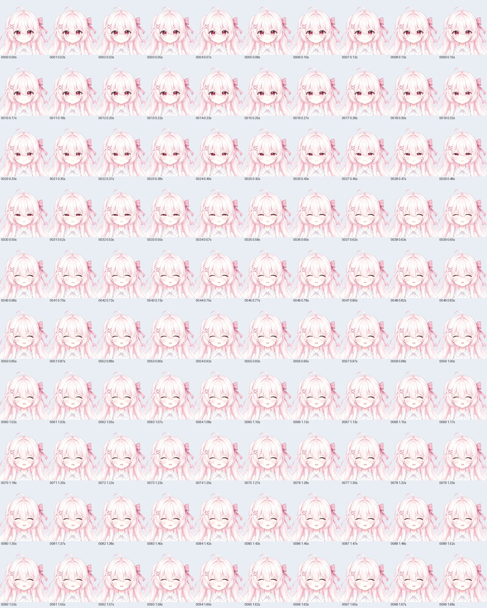
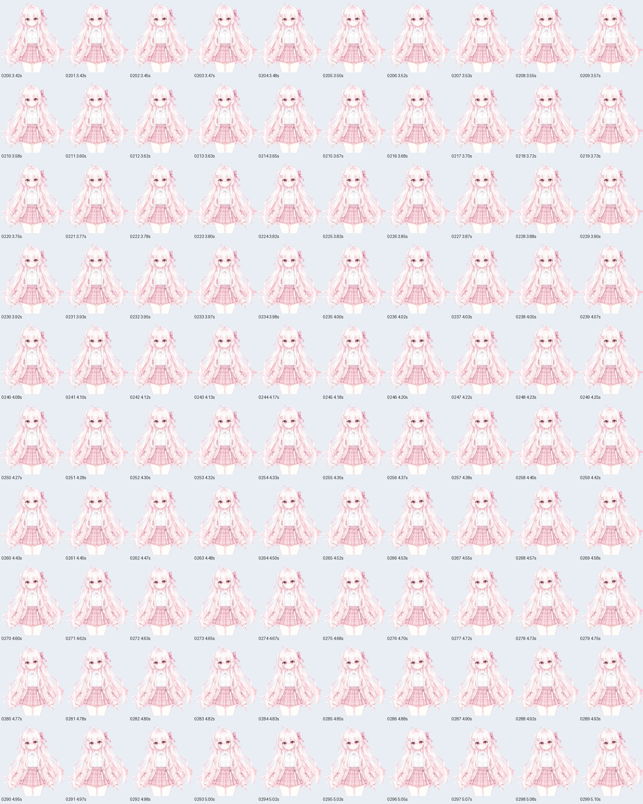

# Continuous motion review · 2026-10-17

这次把后续制作中总结的连续动作检查、接缝诊断、资源身份与可恢复打包方法应用到 Pink Sakura。
**保留现有动作与模型，未新增托下巴、比心或招手。** 运行文件逐字节匹配此前发布版本；
私有角色的素材、绑定和验收数字没有移入示例。

| 本次实测 | 结果 | 证据 |
| --- | --- | --- |
| 原生 Core 6.0.257 | 202 个姿态；24 参数 / 26 Drawable；错误、警告为空 | [native-core.json](native-core.json) |
| 资源引用与原生证据 | 通过；绑定当前 MOC SHA | [structural.json](structural.json) |
| 实际 WebGL | 22 项通过；零设备申请 | [web-smoke.json](web-smoke.json) |
| 静态矩阵 | 66 姿态 / 91 张截图重新采集，独立于连续帧 | [static-poses.json](static-poses.json) |
| 实际连续播放 | 6 条轨迹 / 1,488 个完成绘制帧；最大间隔 35.7 ms | [continuous.json](continuous.json)、[每帧参数与图片 SHA](frames.jsonl) |
| 中性复位 | 六条轨迹前后，当前画布完整 RGBA SHA 相同 | 同上；这是同版本复位，不是跨版本脸部对比 |
| 运行包恢复 | 新目录解压；12 成员，CRC、普通文件与逐文件 SHA 全通过 | [recovery.json](recovery.json) |
| 单元与仓库检查 | 61 Python / 35 Node；kit 校验通过 | [summary.json](summary.json) |

输入身份见 [inputs.json](inputs.json)。MOC 仍为
`ba9c30d1a8a6382dad388caa67bf0baad944fc618b171bcb95613e4f7b6b19ae`，
8192² 图集仍为 `8f0df8c8ec968dbebb6d1f89a8afd708a3f5843b1fae7b70a9d9cf31146d5361`。
超分模型沿用 **`realesr-animevideov3-x4`**，获取来源和两个权重 SHA 见
[锁文件](../../../../tools/upscale-model-lock.json)。本次不重做神经超分或引擎冷编译。

## 轨迹与检查方式

| 轨迹 | 完成帧数 | 范围 |
| --- | ---: | --- |
| Idle | 383 | 播放现有循环动作 6.5 秒 |
| Blink | 101 | 播放现有眨眼动作及结束段 |
| Nod | 149 | 播放现有点头动作及结束段 |
| Shake | 148 | 播放现有摇头动作及结束段 |
| Face cycle | 354 | 双眼开合、左右眉反向、嘴形 × 张口、小幅头动；保持、中途反向及重复 |
| Body/hair cycle | 353 | 头身反向与全部现有 hair 参数的连续往返 |

独立浏览器真实载入本地模型；在测试进程内包装 Pixi 的 `render`，原方法返回后才读取画布。
RAF 仅驱动合成参数，不用于计数；轨迹内部不 reset，不把静态截图伪称实际播放。
实际模型、MOC、纹理、物理、动作与显示信息的初始响应 SHA 都与预览清单匹配。
脚本核对参数到达 Core、有限顶点/透明度、完成帧数和复位结果；它不进行全插值三角形质量证明。

PNG 编码会增加负载，帧间隔是此次采集环境的观测值，不代表普通播放性能。
不同机器的帧数会变；超过 250 ms 的间隙使脚本失败，应调查性能或重新采集。
首次开发运行因报告中同名字段覆盖失败，修正后完整重跑；这里发布的只有第二轮完整结果。

## 视觉范围与剩余限制

全部 1,488 帧通过 **18 张编号接触表做缩略概览**，另检查 5 张原尺寸 PNG。
自动报告仍写 `visualReview: pending`；独立的[目视记录](visual-review.json)说明实际范围。
本次没有逐张重新精检全部 91 张静态姿态，也不把缩略概览称为原尺寸逐像素检查。

| 脸部连续过程节选 | 头身与发丝连续过程节选 |
| :---: | :---: |
| [](face-cycle-0000.jpg) | [](body-hair-cycle-0200.jpg) |

所查轨迹在概览尺度未观察到新的大块断开或部件消失。半闭眼睫毛仍偏厚、端部偏钝，
`EyeOpen` 0–0.25 仍有闭眼停留段；细唇线、发丝 alpha 和很小的肤色接缝没有因此全部排除。
半身取景在大幅摆发时会裁掉最外侧发梢，不能据此验收完整发尾轮廓。
只有每帧参数、PNG SHA 与两张节选接触表进入仓库；完整原尺寸 PNG 保留在本地，重跑脚本即可生成新证据。
截图属于 Pink Sakura 衍生素材，沿用 [CC BY 4.0 许可](../../LICENSE.md)。

## 复跑

从仓库根目录按[示例步骤](../../README.md#复现模板)准备新的预览目录和本地依赖，
确认所选端口空闲，再启动服务器。无需既有 `work/`；Core、浏览器依赖和权重仍按指引另行取得。

```sh
PLAYWRIGHT_MODULE=/path/to/node_modules/playwright \
node examples/pink-sakura/check-continuous.cjs \
  http://127.0.0.1:8837/ work/pink-continuous-new
node --test tests/test_continuous_review.cjs
python3 -m unittest discover -s tests -v
bash scripts/validate.sh --kit
```

如使用已有 Chrome，可设置 `PLAYWRIGHT_CHROMIUM_EXECUTABLE`。结果目录必须为空，旧证据不会被覆盖。
静态矩阵继续使用 `check-poses.cjs`；运行包使用 `scripts/package-model.py`，然后解压并核对成员 SHA。
源包离线复建与完整引擎冷编译的边界见[复现指引](../../../../docs/reproducibility.md)。
本轮未申请摄像头，未打开 VTube Studio 或官方编辑器；历史摄像头检查保持原来的代码身份。

提交后的[空目录源包复查](../../../../docs/verification/source-package-e2c4679.json)已通过：`e2c4679` 的公开输入可重建三张眉毛 PNG、24 层 Pink 配方与 16 层几何示例；61 项 Python / 35 项 Node 测试也在该副本中通过。它没有依赖原来的 `work/` 或缓存；官方 SDK、权重及引擎编译仍属于另外的复现阶段。
