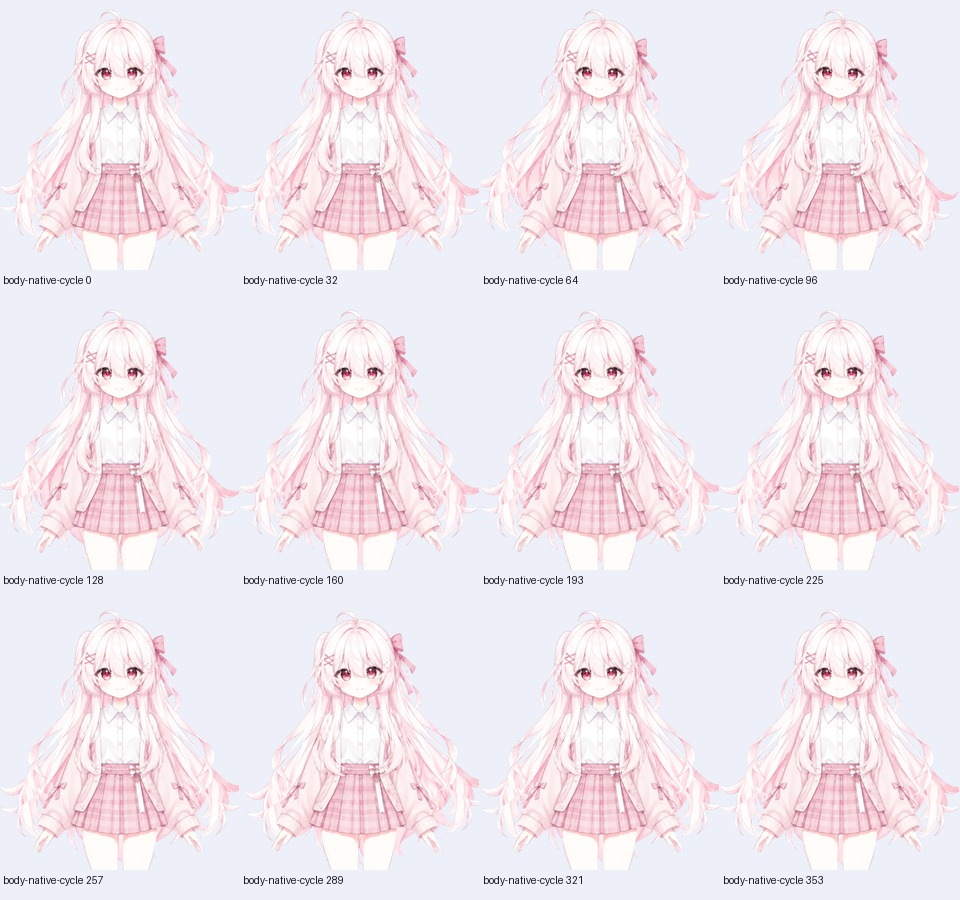
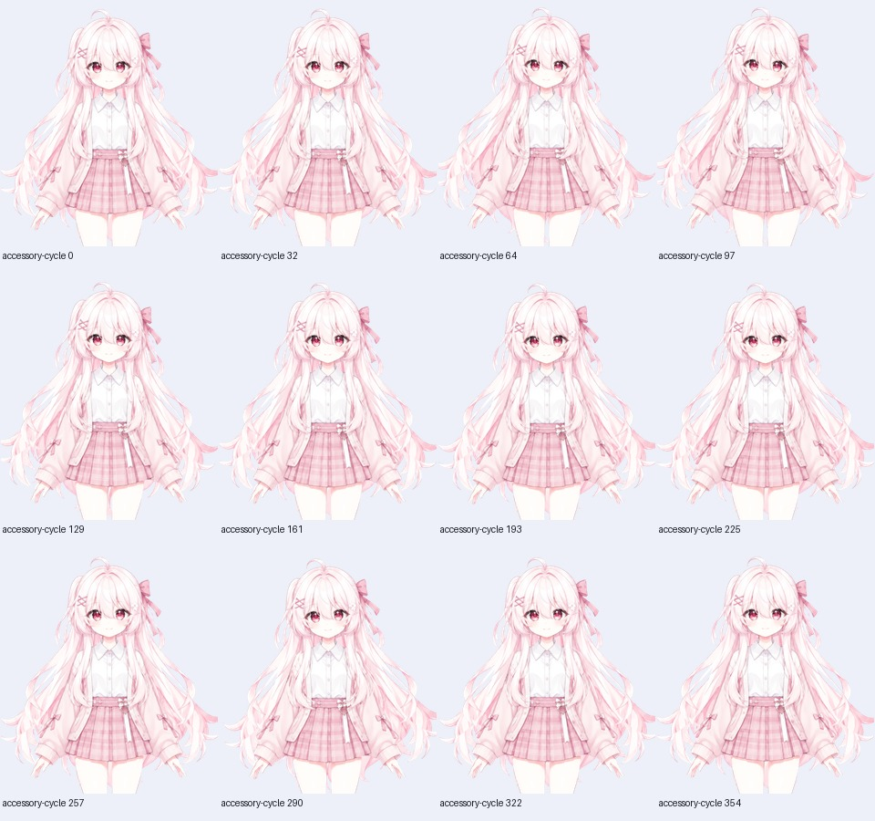
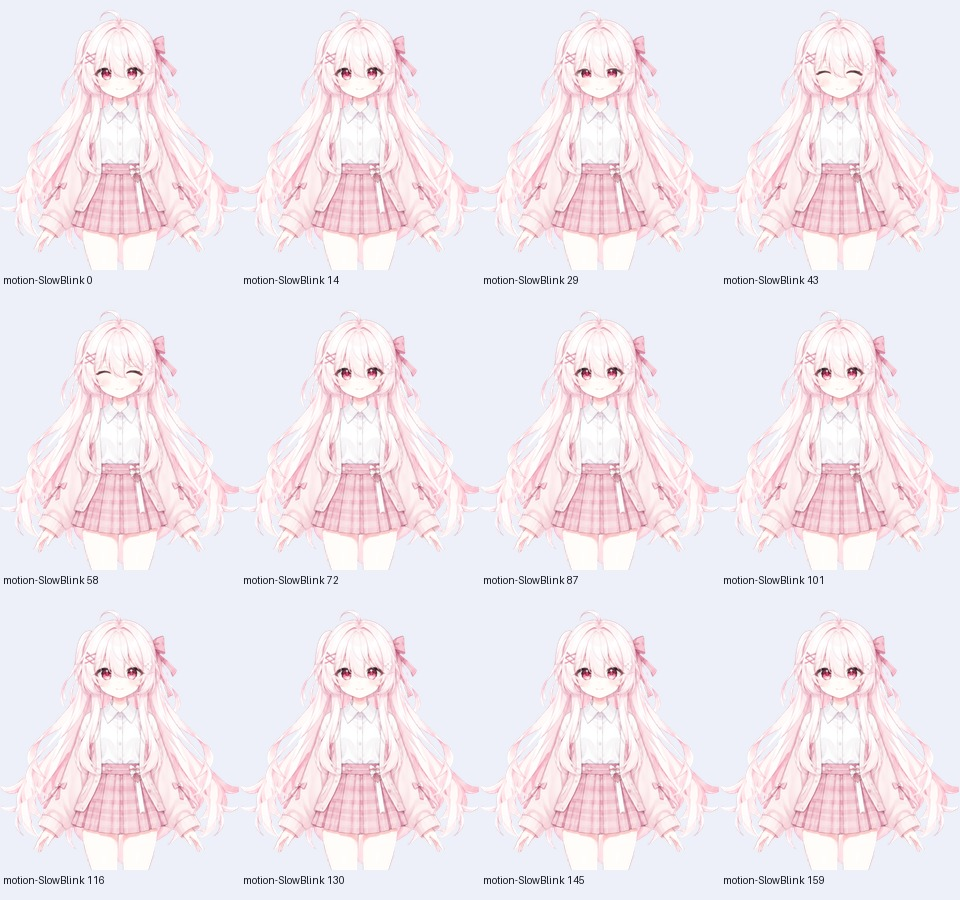
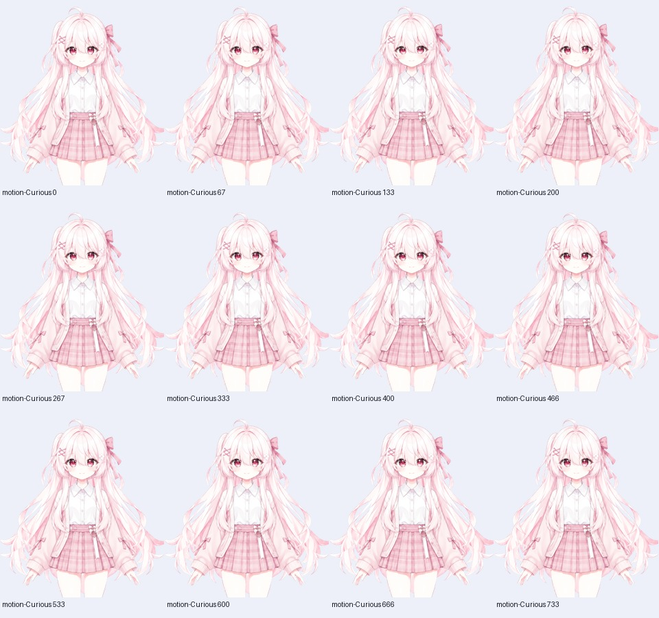

# Pink Sakura：身体与配件动态

这一轮从 2026-10-20 开始，**最终方向修正与复测于 2026-10-21 完成**。当前模型为 37 参数、26 Drawable、14 组物理、8 个表情和 10 个动作。旧眉毛版本的画面、Core 报告和真实摄像头记录保留为历史，不替新版通过验收。

新增双肩、胸腰、轻微上臂、袖口、裙摆和蝴蝶结动态，以及 Float / Wind。衣袖与手保持连续原图；没有增加托下巴、比心或招手。正向上臂输入表示向外摆动，已在实际 Core 顶点上验证左右方向。

| 检查 | 本轮结果与证据 |
| --- | --- |
| 原生 Core | [228 个姿态](native-core.json)，37 参数；所查姿态没有翻转或退化三角形。`ParamWind` 的静态警告保留，因为它只作为物理输入。 |
| 真实网页 | [38 项 WebGL 检查](web-smoke.json)；Chrome 155.0.8059.86 / Playwright 1.62.1 / Web Core 5.1.0，无设备请求。 |
| 动态回归 | [8 项检查](dynamics.json)：中性脸部区域 0 像素变化、左右上臂外展方向、动作衔接、风驱动、暂停与停止清理。画布其余区域有 11 像素发生最多 1 级通道变化，不宣称整帧逐位一致。 |
| 连续播放 | [摘要](summary.json)：22 条轨迹、**6,597 个完成绘制帧**，每条都检查中性复位。包含全部 10 个动作、8 个表情过渡及脸部/头身发丝/身体/配件组合。 |
| 视觉抽查 | [记录](visual-review.json)与[选帧清单](selected-frames.json)：128 帧接触表概览，另看 3 张原尺寸细节。没有逐帧精细目检全部 6,597 帧。 |
| Minimal 回归 | [192 姿态 Core](minimal-core.json)和[22 项 Web 检查](minimal-web.json)。最终集成再次导出的 Minimal MOC 与同轮已检查文件逐字节一致。 |
| 构建与高清身份 | [构建记录](build.json)：实际编译并导出 LOW/HD；LOW 与 HD MOC 一致。使用 Gradle 依赖缓存，没有重新做空缓存引擎构建。 |
| 打包 | ZIP CRC、解包字节与公开 runtime 一致；文件哈希在 [release-metadata.json](../../runtime/release-metadata.json)。 |

## 画面抽查

| 身体往返与反向 | 配件摆动 |
| --- | --- |
|  |  |

| 慢眨眼 | 好奇待机 |
| --- | --- |
|  |  |

[脸部组合](face-cycle.jpg) · [微风](motion-Airy.jpg) · [困倦待机](motion-Sleepy.jpg) · [说话微动](motion-SpeechBob.jpg) · [微笑](expression-Smile.jpg) · [柔和微笑](expression-SoftSmile.jpg) · [左眨眼](expression-WinkLeft.jpg) · [右眨眼](expression-WinkRight.jpg) · [惊讶](expression-Surprised.jpg) · [得意](expression-Smug.jpg) · [生气](expression-Angry.jpg) · [困倦](expression-Sleepy.jpg)

## 可复查的数据

[continuous.json.gz](continuous.json.gz) 是完整原始 JSON 的无损压缩，含每帧时间、实际参数、请求参数、PNG SHA、载入资源和代码身份；PNG 全集保留在作者本地测试归档，没有作为构建输入。可用系统 gzip 解开：

```sh
gzip -dc examples/pink-sakura/verification/dynamics-20261020/continuous.json.gz > /tmp/pink-continuous.json
```

用公开脚本在已准备好的新版预览重跑，输出应是空目录：

```sh
node examples/pink-sakura/check-continuous.cjs http://127.0.0.1:8865/ work/pink-continuous-new
node examples/pink-sakura/check-dynamics.cjs http://127.0.0.1:8865/ http://127.0.0.1:8864/ work/pink-dynamics-new
```

第二条需要另行启动旧版基线预览；两端必须使用相同画布和构图。所需 Playwright 配置见[复现步骤](../../README.md#复现模板)。脚本始终禁止摄像头请求。原始自动报告中的 `visualReview: pending` 保持原样，人工抽查另记，防止自动通过被误读为美术验收。

原画和高清图集未重画。超分模型仍为 **`realesr-animevideov3-x4`**；本轮在 LOW 图集 SHA 与历史神经超分输入完全一致后复用了原 HD 图集，未重跑神经推理。源码中的动态测量文件、生成器和集成代码都已公开，`work/` 中的旧素材不是复现依赖。

## 尚有的限制

- 上臂仅作小幅摆动；自由弯肘、手势和手指需要另行拆层补画。
- 半闭眼睫毛偏厚、端部偏钝，闭唇线放大后仍偏淡；EyeOpen 0–0.25 有闭眼停留段。
- [控制网格](native-dynamics.json)最小单项面积比为 0.8407541。所查 228 个原生姿态没有翻转，不等于全部参数笛卡尔积已穷尽。
- 8192² 图集需要设备支持；没有重跑真实摄像头、30 分钟长跑、VTube Studio 或 Cubism Editor GUI 验收。

截图与接触表属于模型派生画面，按 [CC BY 4.0](../../LICENSE.md) 提供；报告与检查脚本沿用各自的代码/文档许可证。部分 JSON 只脱敏本机路径，`originalLocalReportSha256` 指向脱敏前报告字节，模型和画面 SHA 未改变。
