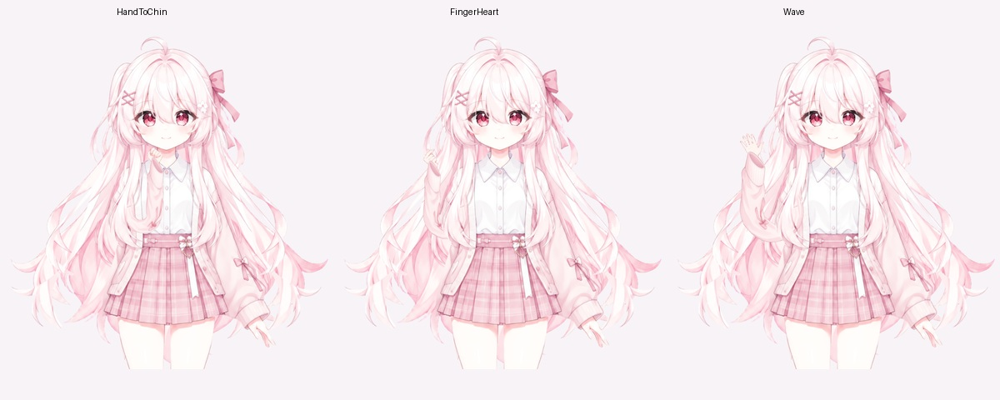
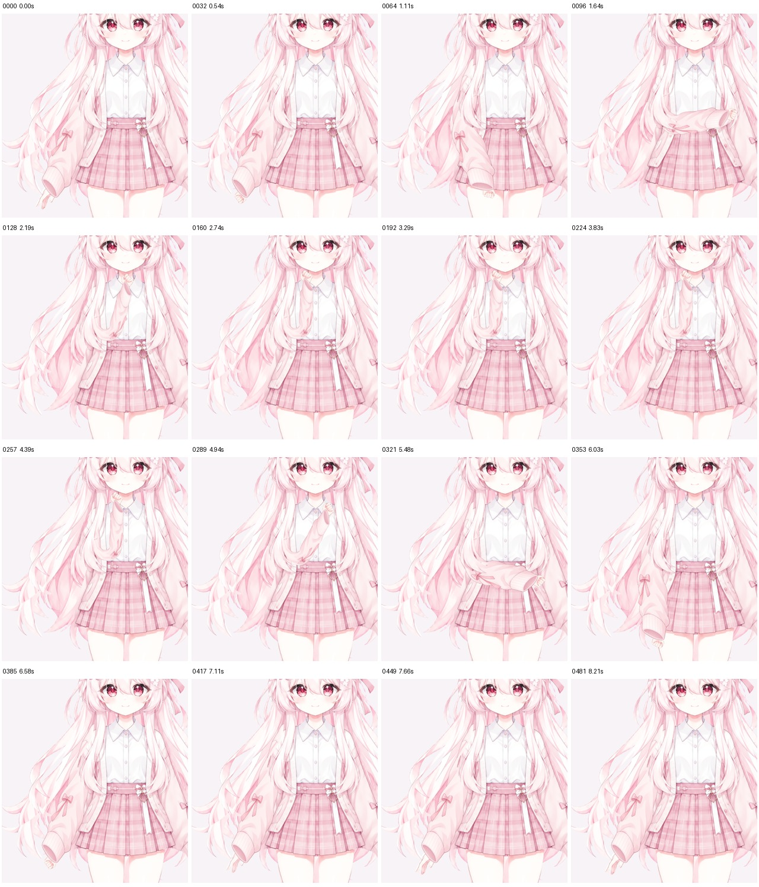
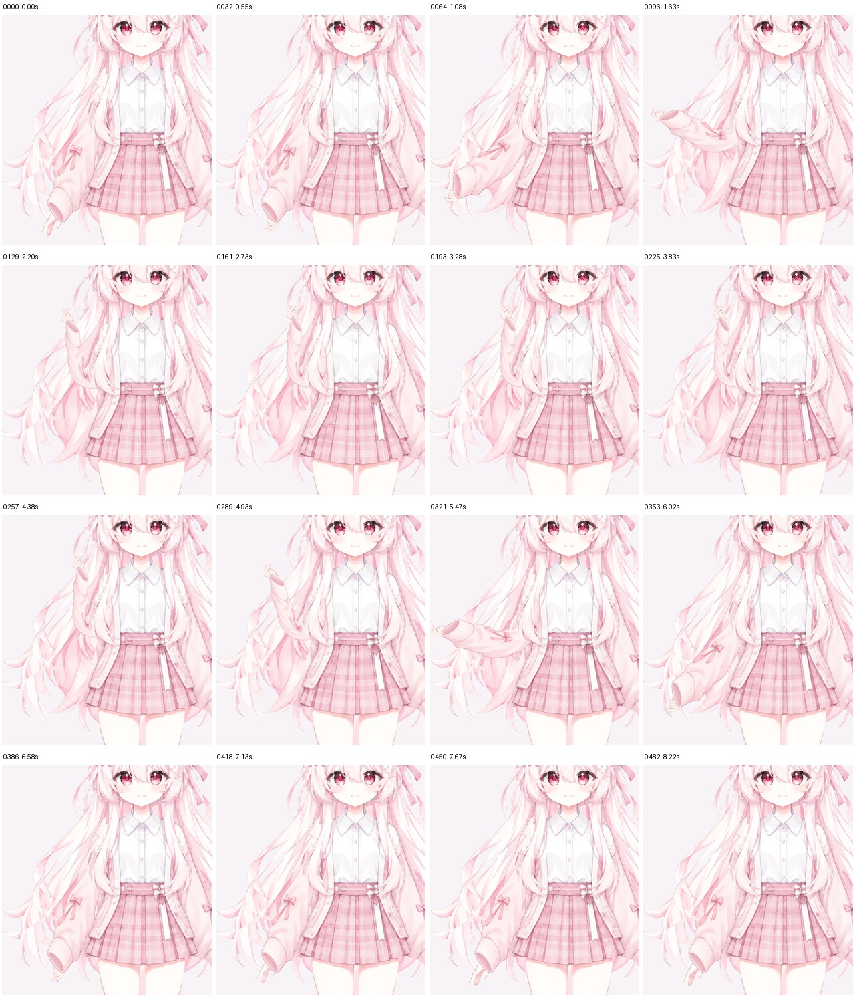
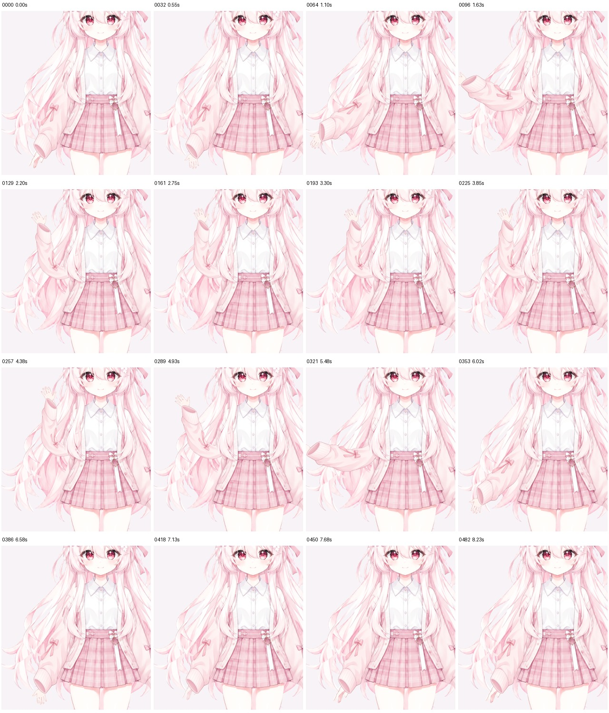

# Pink Sakura：托下巴、指尖比心与招手

本轮为 Pink 单独制作观众左侧（角色右侧）的衣袖和手型，保留原脸。模型现有 **30 个源层、41 参数、32 Drawable、14 动作、8 表情和 14 组物理**。手势是预设动画，不是摄像头手指识别。



## 实现与使用

一块连续袖片负责弯肘，同路径袖口覆盖手腕根部。放松手取自原图，另三种手型来自内置图像工具生成的透明素材；服务型号未知，不沿用原参考图的 Image2.5 版本标注。源图、测量和 JDK 21 配准脚本均公开，见[复现步骤](../../README.md#复现模板)。

网页播放 `HandToChin`、`FingerHeart`、`Wave`，中途切换时先放下旧动作，再换手型；`HandDown` 主动放下。自定义输入也应先把 `ParamArmRLift` 降至 0，再调整 `ParamArmRPose` / `ParamHandRForm`。半整数 Pose 会经过放下位置，不能当作任意中间手势。手型切换有短暂藏入袖口的间隔。

早期候选中的紧弯曲线和非线性横截面压缩出现过内肘网格翻转，因此没有发布。当前用方向角与段长插值、较宽圆弧及统一横截面缩放；17×17 Lift/Pose 组合点之外，还检查了 4,608 个局部插值。数值正面积不能替代衣料外观检查。

## 本轮证据

| 检查 | 结果与范围 |
| --- | --- |
| [原生 Core](native-core.json) | 236 姿态、41 参数、32 Drawable、7,411 顶点、12,107 三角形。静态 Wind、ArmRPose、HandRWave 无直接变化提示保留：后两者需配合 Lift 与手型。 |
| [真实网页](web-smoke.json) | 38 项通过；Chrome 155.0.8059.86、Playwright 1.62.1、Web Core 5.1.0；实际响应 MOC/纹理 SHA 匹配，设备请求为 0。 |
| [手势连续记录](summary.json) | 三种完整动作、三条反向重复与六种互切共 12 轨迹、6,921 个完成绘制帧。逐帧检查有限坐标、三角形方向及可见手型数量。 |
| [主动放下补测](handdown.json.gz) | 另 3 条从抬手中断到 HandDown 的路径、889 帧；合计 **15 轨迹、7,810 帧**。没有网格翻转、抬手缺掌或多手重叠。 |
| [记录复审](frame-audit.json) | 原捕获报告不改写，另查时间间隙和抬手缺掌。最大间隔约 41.3 ms；Lift > 0.05 时没有缺掌帧。 |
| [姿态回归](web-poses.json) | 91 张实际画布，覆盖眉、嘴眼组合、头身与头发；44 张脸部概览另行查看。 |
| [Minimal Core](minimal-core.json) / [Web](minimal-web.json) | 最终适配器实际导出，192 姿态 Core 与 22 项 Web 通过。 |
| [构建身份](build.json) | 最终 LOW 重导出 MOC、图集与已测试输入相同；LOW/HD MOC 一致。用了已有 Gradle 依赖缓存。 |
| [独立源码包](../../../../docs/verification/source-package-f41437c.json) | 提交 `f41437c` 的无旧 work/cache 副本通过 65 项 Python、82 项 Node 测试；3 张眉毛、4 张手臂配准图逐字节重建一致，Pink 30 层与 Minimal 16 层配方生成通过。此检查不执行引擎或超分。 |
| [新超分](upscale.json) | 实际重新运行 `realesr-animevideov3-x4`，2048² → 8192²；RGB 神经推理、独立 alpha。没有复用上轮图集。 |
| 打包 | 仅运行依赖与独立署名/许可文本；ZIP CRC 和解包字节核对通过。见 [release-metadata.json](../../runtime/release-metadata.json)。 |

几何范围和视觉范围分开记录。[局部几何报告](native-gestures.json)的最小 key 面积比约 0.0901，连续组合中的最小值约 0.0908；这表示弯肘存在较大压缩，不能将“没有翻转”写成“形变接近刚体”。

## 视觉复核

[选帧表](selected-frames.json)记录 192 个按时间排列的手臂画面。查看了这些肩、肘、袖口和手掌概览，并查看 44 个脸部姿态概览与 3 张完整手势图。**另看主动放下的 48 个选帧；未逐帧精细目检全部 7,810 帧。** 结论及剩余问题在[视觉记录](visual-review.json)，原自动报告的 `visualReview: pending` 保留。

| 托下巴 | 指尖比心 | 招手 |
| --- | --- | --- |
|  |  |  |

[托下巴反向](reverse-repeat-0.jpg) · [比心反向](reverse-repeat-1.jpg) · [招手反向](reverse-repeat-2.jpg)

[托下巴→比心](HandToChin-to-FingerHeart.jpg) · [托下巴→招手](HandToChin-to-Wave.jpg) · [比心→托下巴](FingerHeart-to-HandToChin.jpg) · [比心→招手](FingerHeart-to-Wave.jpg) · [招手→托下巴](Wave-to-HandToChin.jpg) · [招手→比心](Wave-to-FingerHeart.jpg)

主动放下：[托下巴](HandToChin-to-HandDown.jpg) · [比心](FingerHeart-to-HandDown.jpg) · [招手](Wave-to-HandDown.jpg)，对应 [48 帧选帧表](handdown-selected-frames.json)。

脸部概览：[眉毛](face-regression-1.jpg) · [眨眼与转头](face-regression-2.jpg) · [嘴型组合一](face-regression-3.jpg) · [嘴型组合二](face-regression-4.jpg)。这些缩小概览不能排除原尺寸下的细微肤色/透明边差异。

## 重跑与数据

```sh
PLAYWRIGHT_MODULE=/path/to/node_modules/playwright \
PLAYWRIGHT_CHROMIUM_EXECUTABLE=/path/to/chrome \
node examples/pink-sakura/check-gestures.cjs \
  http://127.0.0.1:8870/ work/pink-gesture-check-new
```

先按[预览准备步骤](../../README.md#复现模板)启动自己的模型服务。输出目录必须为空；浏览器检查会拒绝摄像头请求。当前脚本还包含单独的 HandDown 中断路径，可用第三个参数 `hand-down` 只复查这一组。

[continuous.json.gz](continuous.json.gz) 包含完整连续报告、参数、时间与各 PNG 的 SHA；PNG 全集留在本地检查归档，不作为重建输入。JSON 仅脱敏本机路径，`originalLocalReportSha256` 标识脱敏前字节。自动记录与目视记录不能相互替代。

新图集 SHA-256：`b8a59463858c8b94f5a296e06e918946e2e8be90149e3a379c7d4f9b1fb6957e`。新 MOC：`4ce948a92454589668b24caf3d928362a5251d3e415e0733ec5356e01f4fa745`。原生/网页报告中的身份均对应这一版；旧眉毛与身体动态记录仍作为历史保留。

## 剩余限制

- 抬起时袖子会收窄，褶皱和蝴蝶结会随网格拉伸；是二维手势，尚非多角度重绘衣料。
- 三种绘制手型没有逐指自由绑定；手型过渡刻意在袖内完成。VTS 直接打断动作的混合方式仍需在该软件里复查。
- 原有半闭眼睫毛偏厚、闭唇线偏淡，EyeOpen 0–0.25 的闭眼停留仍在。本轮没有重画表情库。
- 未重跑真实摄像头、30 分钟长跑、VTS、官方 Editor GUI 或空缓存引擎构建。8192² 图集也未做跨设备性能测试。

截图与接触表按 [CC BY 4.0](../../LICENSE.md) 提供；配方/报告与 GPL 集成分别遵循仓库声明的许可。This project is not affiliated with Live2D Inc.
